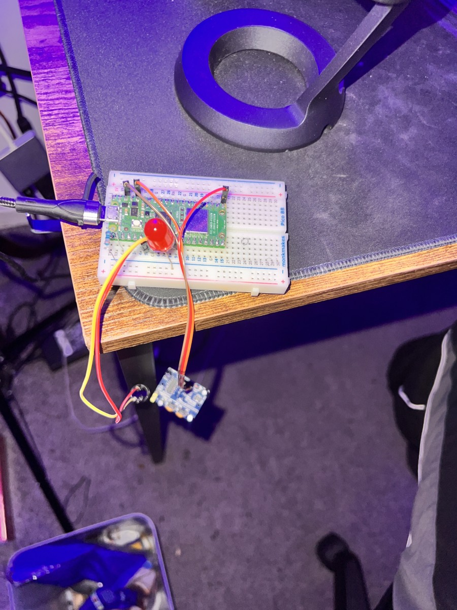
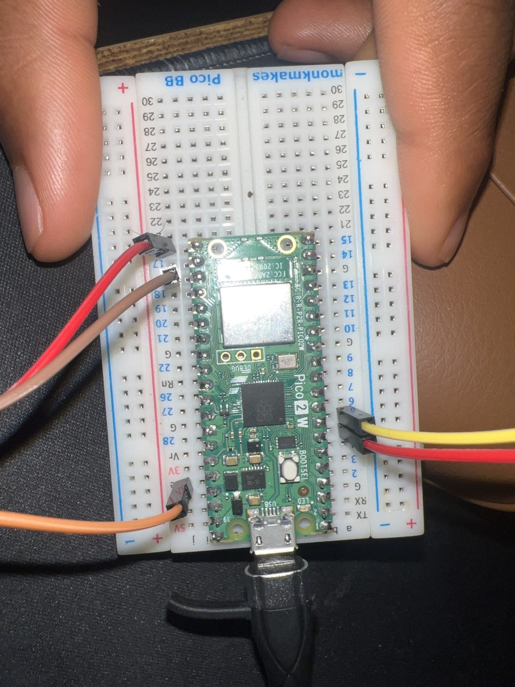
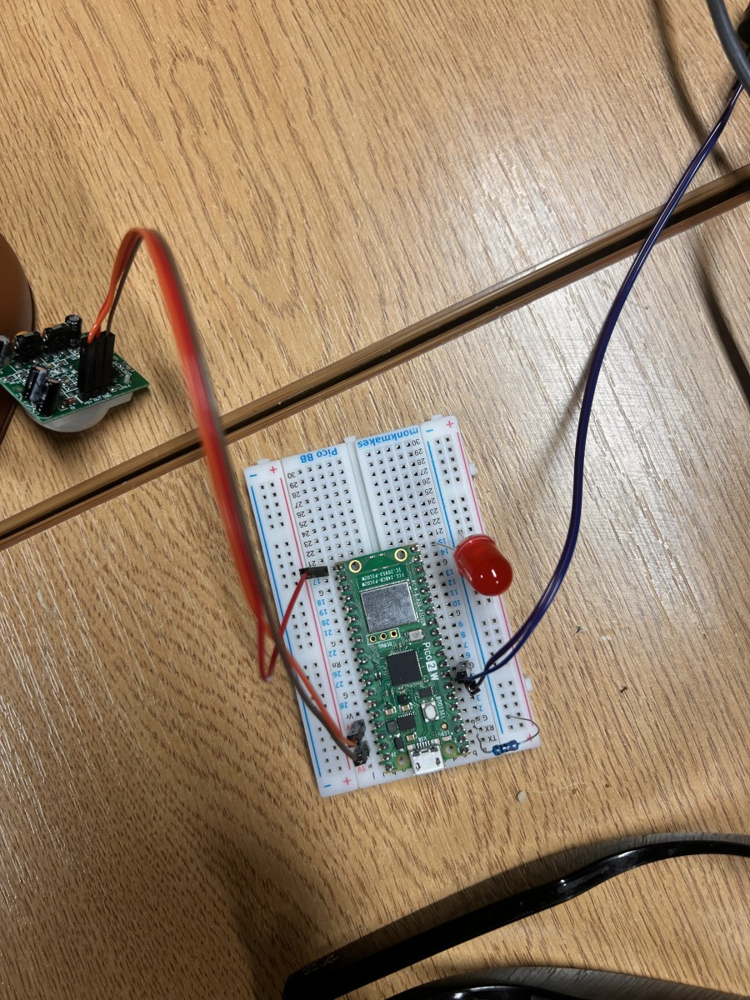

<<<<<<< HEAD
# IoT PicoGuard - Smart Intruder Alarm with Telegram Alerts
=======
# IoT PicoGuard: Smart Intruder Alarm with Telegram Alerts
>>>>>>> 1e69b30 (Remove em dashes from README)


An IoT intruder alarm built on a **Raspberry Pi Pico W** running **MicroPython**. A PIR motion sensor detects movement, a buzzer and LED raise a local alarm, and a **Telegram bot** sends a real-time alert to the owner's phone. The owner can also arm, disarm, check status and pull the event log remotely.

Built as part of *Unit 19: Internet of Things* (college project, 2026).

📝 **Full write-up:** [Medium blog](https://secbyarafai.medium.com/)

---

## Features

- 🚶 **Motion detection:** HC-SR501 PIR sensor with a 300ms debounce filter to stop false triggers
- 🔔 **Local alarm:** siren pattern on an active buzzer plus a flashing LED
- 📱 **Remote alerts:** Telegram push notification within 1–2 seconds of detection
- 🔐 **Remote control:** `/arm`, `/disarm`, `/status` and `/logs` commands, accepted **only** from the owner's chat ID
- 🗒️ **Event logging:** timestamped events saved to `log.txt` on the Pico's flash, so they survive reboots
- 📶 **Self-healing Wi-Fi:** reconnects automatically if the connection drops
- ⏱️ **Cooldown timer:** one movement produces one alert, not a flood of them

## Architecture

The system follows a Machine-to-Machine (M2M) IoT architecture:

```
[ PIR Sensor ] ──GPIO 16──▶ ┌──────────────┐ ──GPIO 5──▶ [ Buzzer ]
                            │ Pico W       │ ──GPIO 9──▶ [ LED ]
                            │ (MicroPython)│
                            └──────┬───────┘
                                   │ Wi-Fi (IEEE 802.11)
                                   ▼
                      HTTPS ⇄ Telegram Bot API ⇄ 📱 Owner's phone
```

| Domain | Role |
|---|---|
| Device | Pico W reads the sensor and drives the buzzer and LED |
| Network | Wi-Fi to the LAN, then HTTPS out to the internet |
| Application | Telegram chat for alerts and remote commands |

## Hardware

| Component | Qty |
|---|---|
| Raspberry Pi Pico W | 1 |
| HC-SR501 PIR motion sensor | 1 |
| Active buzzer | 1 |
| LED + 330Ω resistor | 1 |
| Breadboard + jumper wires | 1 set |
| Micro USB cable | 1 |

**Total cost: £14.50** (target was under £30)

## Wiring

| Component | Pico Pin |
|---|---|
| PIR VCC | VSYS (5V) |
| PIR OUT | GPIO 16 |
| PIR GND | GND |
| Buzzer (+) | GPIO 5 |
| LED (via 330Ω resistor) | GPIO 9 |
| All grounds | GND |

<p align="center">
  
  
  
</p>

## Repository Structure

```
IoT-PicoGuard/
├── README.md
├── main.py                   # the full alarm system
├── secrets.example.py        # copy to secrets.py and add your own credentials
├── tests/                    # step-by-step component tests (from my build log)
│   ├── 01_onboard_led.py
│   ├── 02_flash_led.py
│   ├── 03_buzzer.py
│   ├── 04_pir_sensor.py
│   ├── 05_debounce.py
│   ├── 06_wifi.py
│   ├── 07_telegram_alert.py
│   ├── 08_telegram_commands.py
│   └── 09_event_log.py
└── images/
```

## Setup

1. **Flash MicroPython** onto the Pico W (hold BOOTSEL, plug in, and drag the `.uf2` file across).
2. **Create a Telegram bot:** message [@BotFather](https://t.me/BotFather), run `/newbot` and copy the token.
3. **Get your chat ID:** send your bot a message, then open `https://api.telegram.org/bot<TOKEN>/getUpdates` and copy `chat.id`.
4. **Add your credentials:** copy `secrets.example.py` to `secrets.py` and fill in your Wi-Fi details, bot token and chat ID.
5. **Upload the files** to the Pico with **Thonny IDE**.
6. **Run the tests in order** (`01` → `09`) to confirm each part works.
7. **Run `main.py`**. To start the alarm automatically on power-up, save it to the Pico as `main.py`.

> ⚠️ `secrets.py` is listed in `.gitignore`. Never commit your bot token or Wi-Fi password.

## Telegram Commands

| Command | Action |
|---|---|
| `/arm` | Arm the system |
| `/disarm` | Disarm the system |
| `/status` | Report the current state |
| `/logs` | Send the full event log |

## Results

| Requirement | Result |
|---|---|
| Detect movement with a PIR sensor | ✅ Detection within 300ms |
| Real-time alert to the phone | ✅ Delivered in 1–2 seconds |
| Remote arm/disarm | ✅ Via Telegram commands |
| Local alarm (buzzer + LED) | ✅ Siren pattern on GPIO 5 / 9 |
| Timestamped event log | ✅ `log.txt` on flash |
| Remote log retrieval | ✅ `/logs` command |
| Hardware under £30 | ✅ £14.50 |
| Continuous operation | ✅ 12 hours without failure |

## Security Considerations

Designed with the **ISO/IEC 27400** IoT security and privacy guidance in mind:

- **Access control:** commands are accepted only from the owner's Telegram chat ID
- **Encryption in transit:** all API traffic uses HTTPS
- **Secret handling:** credentials are kept in a git-ignored `secrets.py`
- **Reliability:** Wi-Fi reconnection logic, debounce and cooldown timers

## Future Improvements

- A cleaner, more readable log format
- A fallback alert channel (SMS or email) for when Wi-Fi is down
- An enclosure and battery backup so the device can't simply be unplugged
- PIR sensitivity tuning to further reduce false positives

## Disclaimer

AI-assisted code generation (Claude) was used for parts of the initial code. All code was reviewed, modified, debugged and tested by me, and the system design, integration and evaluation are my own work.

## Author

**Faith Akerele** · [Medium](https://secbyarafai.medium.com/)
